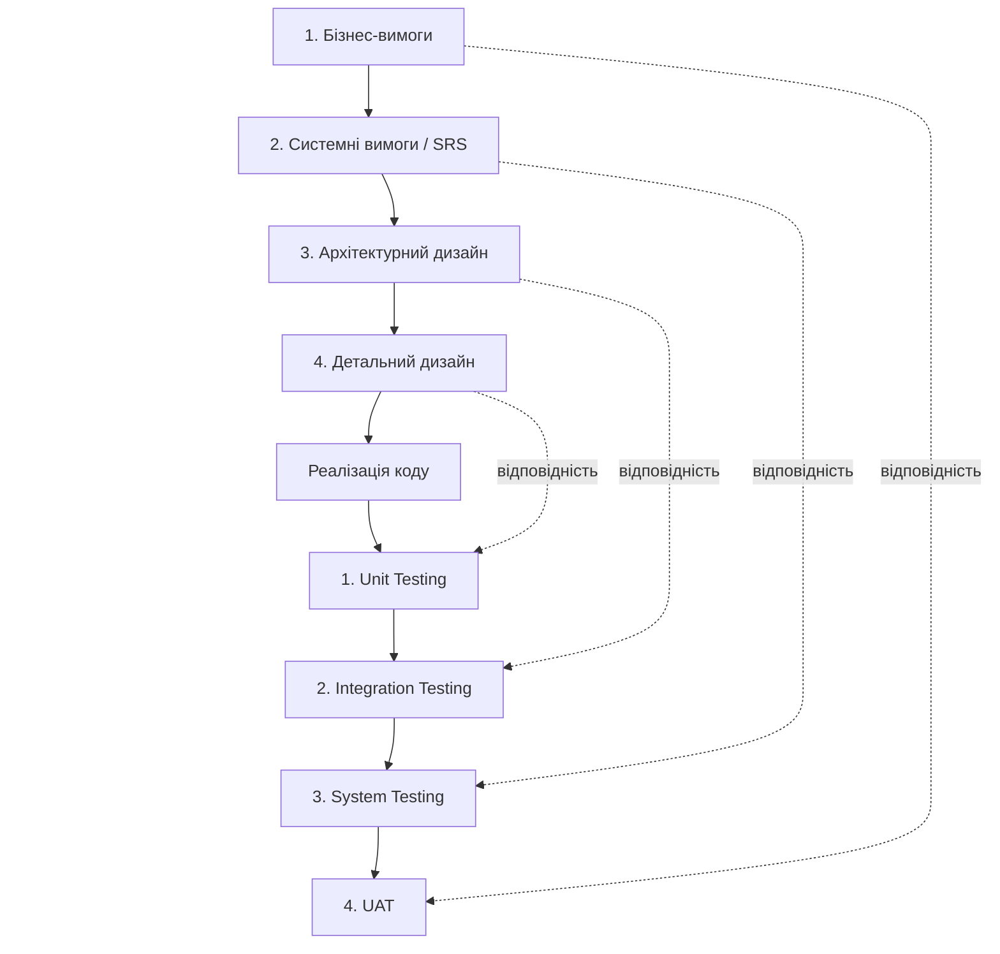

# Лабораторна №4

**Тема:** Моделювання процесів каскадної моделі (Waterfall) та V-моделі.  
**Мета:** Спланувати фази Waterfall і контрольні точки Quality Gates, побудувати матрицю V-моделі та оцінити зміну вимог у проєкті Fixed-Price.

**Навчальний проєкт:** «Розробка та впровадження хмарного прикладного сервісу управління корпоративними знаннями та технічною документацією».

**Обрана підсистема:** модуль **авторизації та розмежування прав доступу** корпоративної бази знань умовної компанії «ТехноСервіс». У системі є адміністратор, редактор і читач. Важливо не допустити доступу сторонніх осіб до внутрішніх документів і заборонити зміну інструкцій користувачам без відповідних прав.


## Крок 1. Моделювання фаз Waterfall SDLC

У Waterfall роботи проходять п'ять основних фаз. Для цієї підсистеми після кожної фази діє **Quality Gate** — перевірка комплектності та якості результату. До наступної фази переходимо після формального **Sign-off** відповідального представника. Такий порядок дисциплінує роботу, але не гарантує, що у вимогах або коді не буде помилок.

### 1. Аналіз та фіксація вимог (Requirements)

Проводжу інтерв'ю з керівницею підтримки, майбутніми користувачами та відповідальним за інформаційну безпеку. Визначаю, хто може входити до системи, хто має права перегляду й редагування, що відбувається за неправильного пароля та як захищати внутрішню документацію. Також фіксую нефункціональні вимоги: захищене з'єднання, ведення журналу подій та коректну обробку помилок.

**Артефакт:** Software Requirements Specification (SRS) — погоджене технічне завдання, наприклад вимоги AUTH-01 (вхід), AUTH-02 (ролі), SEC-01 (обмеження доступу).

**Quality Gate:** Product Owner/уповноважений замовник підписує SRS; вимоги зрозумілі, однозначні, перевірювані та мають критерії приймання.

### 2. Системне й архітектурне проєктування (Design)

Розробляю схему компонентів «браузер → backend API → база даних», ERD зі сутностями **Users, Roles, UserRoles, Sessions, AuditEvents**, опис REST API, послідовність входу користувача та правила перевірки дозволів на сервері. Технічний рецензент перевіряє архітектуру, захист паролів, сеанси та обробку відмов у доступі.

**Артефакти:** Architecture Design Document, ERD, схеми потоків, API-специфікація, коротка модель загроз.

**Quality Gate:** **Architecture Review** пройдено, зауваження усунуто, архітектуру погоджено до початку кодування.

### 3. Реалізація та кодування (Implementation)

Frontend-розробник створює форму входу та інтерфейс; backend-розробник реалізує серверну перевірку облікових даних, створення сеансу, ролі та доступ до документів. Код зберігаємо у **GitHub**, зміни перевіряємо через **pull requests / code review**. Дотримуємося правил безпечного зберігання секретів, не записуємо паролі відкритим текстом. Розробники пишуть **unit-тести** на перевірку пароля, ролей і дозволів.

**Артефакти:** вихідний код, unit-тести, результати автоматичної збірки, реліз-кандидат.

**Quality Gate:** код пройшов рев'ю, unit-тести успішні, реалізація погодженого обсягу завершена й збірка передана в QA.

### 4. Комплексне тестування (Verification / Testing)

QA-інженер отримує реліз-кандидат і тест-план. Він перевіряє відповідність вимогам SRS: успішний і відхилений вхід, права всіх ролей, спроби доступу без авторизації, збої сервера, перевірку інтеграції з БД і критичні сценарії безпеки. Дефекти реєструють, усувають і повторно перевіряють.

**Артефакти:** тест-кейси, дефект-репорти, матриця «вимога → тест», Test Summary Report.

**Quality Gate:** усі критичні сценарії пройдено, відкритих критичних дефектів немає, QA підписує звіт. При цьому тестування планується з ранніх етапів, а не лише після завершення коду.

### 5. Розгортання та здача в експлуатацію (Deployment & Maintenance)

Команда готує резервні копії, налаштування середовища, інструкцію адміністратора, план відкату та розгортає перевірений реліз. Представники замовника виконують **User Acceptance Testing (UAT)**, перевіряючи робочі сценарії. Після погодження система передається в експлуатацію й підтримку.

**Артефакти:** реліз, інструкції, протокол UAT, акт приймання-передачі.

**Quality Gate:** **UAT Sign-off** і формальне приймання замовником; визначено відповідальних за підтримку.

### Зведена таблиця фаз та контрольних точок

| Фаза Waterfall | Вхідні артефакти (Inputs) | Відповідальна роль | Критерій завершення (Quality Gate / Deliverable) |
|---|---|---|---|
| 1. Вимоги (Requirements) | Business Case, Project Charter, інтерв'ю з працівниками та керівником підтримки | Business Analyst (функції аналітика виконує PM) | SRS із функціональними та нефункціональними вимогами, матрицею ролей і критеріями приймання; **письмове затвердження Product Owner/замовником (SRS Sign-off)** |
| 2. Проєктування (Design) | Підписаний SRS, бізнес-правила, вимоги до безпеки | Solution Architect (архітектурне рев'ю — backend-розробник із залученням незалежного технічного рецензента) | Архітектурна схема, ERD, опис REST API, діаграма входу та модель загроз; **Architecture Review і підписане погодження технічного рішення** |
| 3. Реалізація (Implementation) | Затверджений дизайн, контракти API, правила кодування | Developers: frontend- та backend-розробники | Код у GitHub, pull requests із code review, unit-тести, результати CI; **code freeze, реліз-кандидат і технічний sign-off на передачу до QA** |
| 4. Комплексне тестування (Testing) | Реліз-кандидат, SRS, тест-план, тест-кейси, середовище QA | QA Engineer (за підтримки розробників) | Трасування вимог до тестів, функціональні/інтеграційні/системні та безпекові перевірки, звіт про дефекти; **Test Summary Report, відсутність критичних відкритих дефектів і QA Sign-off** |
| 5. Розгортання й підтримка (Deployment & Maintenance) | Перевірений реліз, Test Summary Report, інструкція впровадження, план резервного відновлення | DevOps-функції — технічна команда; PM координує, замовник приймає | Демонстрація для замовника, UAT, запуск, інструкція користувача й передача в підтримку; **підписаний UAT Sign-off / акт приймання-передачі** |

**Послідовність:** Requirements → *SRS Sign-off* → Design → *Architecture Sign-off* → Implementation → *Code Sign-off* → Testing → *QA Sign-off* → Deployment & Maintenance → *UAT Sign-off*.

## Крок 2. Матриця Verification & Validation (V-Model)

У V-моделі **ліва гілка** описує послідовне уточнення вимог і дизайну до рівня коду, а **права** — рівні перевірки, заплановані відповідно до артефактів лівої гілки. Тестування проєктується заздалегідь, щоб кожну вимогу можна було простежити до конкретного тесту.

### Матриця відповідності рівнів

| Рівень розробки (ліва гілка V) | Артефакт у моєму проєкті | Рівень тестування (права гілка V) | Що перевіряємо? |
|---|---|---|---|
| **1. Бізнес-вимоги** | Працівники повинні безпечно отримувати доступ до внутрішніх інструкцій; лише редактори можуть змінювати матеріали; бізнес-ціль — скоротити час пошуку | User Acceptance Testing (UAT) | Представник замовника перевіряє сценарії: читач входить і переглядає інструкцію; редактор може створювати документ; результат відповідає потребам роботи |
| **2. Системні вимоги (SRS)** | AUTH-01: вхід за email і паролем; AUTH-02: три ролі; SEC-01: заборона неавторизованих дій; NFR-01: журнал помилок входу без розкриття паролів | System Testing | Перевірка всієї системи: правильний/неправильний пароль, сеанси, ролі, відмова в доступі, захист від типових атак і робота під тестовим навантаженням |
| **3. Архітектурний дизайн** | Клієнтський вебінтерфейс → REST API → база даних; таблиці Users, Roles, UserRoles, Sessions, AuditEvents; контракти API для входу та перевірки прав | Integration Testing | Чи узгоджено працюють frontend, API та БД; чи правильно створюються сеанси, передаються помилки та зберігаються ролі |
| **4. Детальний дизайн компонентів** | Функції перевірки облікових даних, хешування/перевірки пароля, визначення ролі, дозволу на створення документа | Unit Testing | Окремі функції правильно обробляють дійсний/хибний пароль, невідому роль, відсутній дозвіл та некоректні дані |

### Графічна V-подібна схема

Схема показує спуск від бізнес-вимог до реалізації та підйом через послідовні рівні тестування; пунктирні зв'язки — відповідність між розробкою і перевіркою.



Для перегляду навіть без підтримки Mermaid відповідність рівнів така:

```text
Бізнес-вимоги                             UAT
    \                                      /
     Системні вимоги                  System Testing
        \                              /
         Архітектурний дизайн    Integration Testing
             \                      /
              Детальний дизайн  Unit Testing
                     \          /
                      Реалізація
```

### Приклади простежуваності вимог

| ID вимоги | Суть вимоги | Де перевіряємо |
|---|---|---|
| AUTH-01 | Користувач входить за email і паролем | Unit: перевірка пароля; Integration: вхід через API; System: повний сценарій входу |
| AUTH-02 | Лише редактор і адміністратор створюють інструкції | Unit: перевірка права; Integration: API повертає заборону; System/UAT: читач не може створити документ |
| SEC-01 | Неавторизований користувач не бачить внутрішніх документів | Integration: перевірка доступу; System: спроби доступу без сесії; UAT: користувач бачить лише дозволені матеріали |

**Висновок до кроку 2:** V-модель дає змогу не тільки реалізувати модуль, а й показати, яким тестом підтверджується кожна важлива вимога. Для авторизації це особливо важливо, бо помилка може відкрити доступ до внутрішньої інформації.

## Крок 3. Change Request, Fixed-Price і Cost of Change

### Умови сценарію

Це **окремий гіпотетичний контракт із завдання викладача**, а не зміна нашого початкового MVP:

- **Контракт:** Fixed-Price — **$40 000**.
- **Тривалість:** **4 місяці**.
- **Момент запиту:** кінець **3-го місяця**, фаза тестування.
- **Початкове рішення в цьому сценарії:** авторизація через SMS.
- **Нова вимога замовника:** замість SMS реалізувати інтеграцію з **BankID НБУ** та **Дія.Підпис** із додатковою перевіркою цифрового підпису.

Важливо: **BankID НБУ** — система дистанційної ідентифікації, а **Дія.Підпис** може використовуватися для авторизації та підписання. Це різні інтеграційні механізми. Перевірка електронного підпису — окрема вимога, яку треба чітко описати (що саме підписується, як перевіряється підпис і яким має бути результат). Технічну можливість підключення, договори з провайдерами й тестові середовища необхідно підтвердити до обіцянки строків.

### 1. Impact Analysis — вплив на проєкт

Пізня зміна змушує повернутися до вже пройдених етапів **лівої гілки V-моделі**, потім повторити пов'язані тести правої гілки:

| Етап | Що доведеться переробити | Оновлені артефакти |
|---|---|---|
| Бізнес-вимоги і SRS | Перевизначити способи ідентифікації, згоду користувача, дані від провайдера, вимоги до електронного підпису, сценарії відмови і критерії приймання | Нова версія SRS; оновлена матриця трасування; CR-погодження |
| Архітектура й детальний дизайн | Перепроєктувати потоки авторизації, інтеграції зовнішніх провайдерів, сеанси, мапування ідентичностей, перевірку підпису, захист персональних даних та аудит | Оновлені C4/sequence-діаграми, ERD, API-контракти, модель загроз |
| Реалізація | Прибрати SMS-залежність у заданому сценарії, додати підтримку BankID і Дія.Підпис, перевірку отриманих даних та підпису, обробку помилок | Новий код, конфігурації, документація, unit-тести |
| Перевірка і приймання | Переписати тест-кейси, провести unit, integration, system, security, regression і UAT; повторити перевірки після виправлень | Оновлений тест-план, Test Summary Report, новий UAT Sign-off |

**Додаткові ризики:** залежність від зовнішніх провайдерів, можливі строки отримання доступу, зміни в обробці персональних даних, відмова користувача від передання даних, недоступність зовнішнього сервісу та помилки перевірки електронного підпису. Нові інтеграції не можна вважати готовими лише після отримання відповіді API — потрібно коректно перевіряти довіру до відповіді, права доступу та випадки відмови.

### 2. Cost of Change — оцінка вартості змін

**На етапі Requirements:** припустимо, що аналітику достатньо **2 годин × $100/год = $200** для внесення нових вимог і погодження уточнення *до* побудови архітектури та написання коду. Це умовна оцінка лише раннього коригування вимог, а **не повна вартість реалізації BankID і Дія.Підпис**.

**На етапі Testing:** доведеться переробляти вже створені рішення та повторювати тести. У навчальному прикладі кошторис становить:

| Стаття додаткових витрат | Сума |
|---|---:|
| Аналіз вимог, погодження нового SRS | $700 |
| Архітектура, API, модель загроз та ERD | $1,100 |
| Переробка backend/frontend та інтеграції | $3,600 |
| Модульні й інтеграційні тести | $1,100 |
| Регресія, безпекові перевірки та UAT | $1,100 |
| Документація, реліз і координація | $400 |
| **Разом** | **$8,000** |

**Розрахунок впливу на контракт:**

- Початковий бюджет: **$40 000**.
- Додаткова оцінка: **$8 000**.
- Потенційний новий бюджет: **$48 000**.
- Зростання бюджету: **20%**; умовна вартість пізньої зміни в **40 разів** більша за $200, якщо порівнювати наведені навчальні суми.
- Початковий строк: **4 місяці** → новий **5 місяців** (**+1 місяць, +25% до тривалості**).

Ризик для виконавця: якщо взяти нові вимоги без додаткової угоди, $8 000 можуть перетворитися на збитки команди, а строки й критерії приймання залишаться старими.

### Ілюстративна крива вартості змін

| Фаза виявлення потреби у зміні | Умовна оцінка | Відносна візуалізація |
|---|---:|---|
| Збір вимог | $200 | █ |
| Проєктування | $1,200 | ██ |
| Реалізація | $4,000 | █████ |
| Тестування | $8,000 | ██████████ |
| Після запуску | $12,000 | ███████████████ |

*Цифри для проєктування, реалізації й періоду після запуску — лише приклад, а не статистичний закон. Реальна вартість змін залежить від архітектури, якості тестів, договорів і зовнішніх інтеграцій.*

**Пояснення кривої:** що пізніше надходить вимога, то більше вже затверджених артефактів і зробленої роботи може довестися змінити. Ці витрати зростають через повторне погодження, переробку коду та регресійне тестування.

### 3. Change Request Form — рішення PM

| Поле | Заповнений зміст |
|---|---|
| **Номер запиту** | CR-004 |
| **Назва** | Заміна SMS-авторизації на BankID НБУ / Дія.Підпис із перевіркою електронного підпису |
| **Ініціатор** | Замовник (умовна компанія) |
| **Дата / етап** | Кінець третього місяця, фаза тестування |
| **Початковий обсяг** | SMS-авторизація за погодженим SRS |
| **Запропонована зміна** | Інтеграція з двома зовнішніми способами ідентифікації/авторизації та нові правила перевірки підпису |
| **Причина** | Нове бізнес-рішення замовника |
| **Вплив на артефакти** | SRS, дизайн, ERD, API-контракти, код, тест-кейси, документація та UAT |
| **Додаткова вартість** | Орієнтовно **$8 000** (навчальна оцінка) |
| **Вплив на термін** | Орієнтовно **+1 місяць** |
| **Новий бюджет і строк, якщо погодити зараз** | **$48 000 і 5 місяців** |
| **Альтернатива A — погодити** | Підписати додаткову угоду щодо бюджету, термінів і критеріїв приймання; тільки після цього починати роботи |
| **Альтернатива B — відхилити** | Залишити початкові вимоги, якщо нова потреба не є обов'язковою |
| **Альтернатива C — відкласти** | Здати погоджений реліз із SMS і спланувати BankID/Дія.Підпис для **Release 2.0** за окремою оцінкою |
| **Рекомендація PM** | **Альтернатива C — перенести в Release 2.0**, якщо заміна не є нормативно обов'язковою: так збережемо затверджені бюджет, строк і критерії першої поставки |
| **Хто затверджує** | Замовник / спонсор і уповноважені сторони контракту; PM готує аналіз, але не змінює контракт одноосібно |
| **Статус** | **Рекомендовано, очікує письмового рішення замовника** |

**Обґрунтування рішення:** наприкінці третього місяця ризик зриву дедлайну занадто великий. Перенесення в Release 2.0 дозволяє завершити першу версію за затвердженими умовами. Якщо ж новий спосіб авторизації став **обов'язковим до запуску** з міркувань закону чи безпеки, приймання старої версії не можна вважати допустимою альтернативою без оцінки цих вимог; тоді потрібно погоджувати зміну контракту, строків і бюджету.

## Контрольні запитання

### 1. У чому різниця між верифікацією (Verification) та валідацією (Validation)?

**Verification (верифікація)** — перевірка, чи реалізована система відповідає визначеним вимогам, дизайну та специфікаціям: «Чи правильно ми створюємо продукт?». Наприклад, чи правильно API відхиляє доступ читача до редагування. **Validation (валідація)** — перевірка, чи готова система справді задовольняє потребу користувача: «Чи той продукт ми створили?». Наприклад, чи може працівник швидко знайти потрібну інструкцію. У практиці обидва підходи доповнюють один одного, а тестування може давати докази для обох.

### 2. Чому Waterfall погано адаптується до частих змін вимог?

Тому що вимоги й архітектуру затверджують на початку, а наступні етапи спираються на вже погоджені документи. Зміна пізніше змушує знову погоджувати SRS, переробляти дизайн, код і тести, що потребує часу та грошей. Якщо ринок швидко змінюється, фінальний продукт може вже не відповідати потребам. Waterfall не забороняє зміни, але робить їх формальними й дорожчими за умов жорсткого плану.

### 3. Що таке Quality Gate і навіщо потрібен Sign-off?

**Quality Gate** — контрольна точка між фазами, де перевіряють повноту артефактів, їхню якість та виконання визначених критеріїв. **Sign-off** — формальне підтвердження відповідальною стороною, що результат фази прийнято й можна рухатися далі. Підпис дає спільну погоджену базу для наступної роботи та контроль змін, але не гарантує відсутності помилок.

### 4. Коли Waterfall і V-Model доречніші за Agile/Scrum?

Коли вимоги достатньо стабільні й повністю документовані, результат має проходити формальне погодження, діють суворі нормативні або контрактні обмеження, важливі простежуваність вимог і незалежні докази тестування, а помилки можуть мати великі наслідки. Приклади — критичні функції медичних, фінансових або державних систем. При цьому Agile також може застосовуватися у відповідальних галузях, якщо забезпечено потрібні процедури якості та відповідності.

## Загальний висновок

Під час лабораторної роботи я розглянув критичний модуль авторизації хмарної бази знань і змоделював його розробку за Waterfall. Описав п'ять фаз, документи та контрольні точки Quality Gates, побудував матрицю й схему V-моделі. Також проаналізував Change Request за контрактом Fixed-Price: у навчальному прикладі пізня зміна збільшує бюджет на **$8 000 (20%)** і відтерміновує завершення на **1 місяць**. Я зрозумів, чому важливо заздалегідь погоджувати вимоги, планувати перевірки й формально оформлювати зміни.

## Джерела

1. [IBM — What is the software development life cycle (SDLC)?](https://www.ibm.com/think/topics/sdlc).
2. [ISTQB / ASTQB — Testing in the Context of a Software Development Lifecycle (V-model)](https://astqb.org/2-1-testing-in-the-context-of-a-software-development-lifecycle-sdlc/).
3. [Національний банк України — BankID НБУ](https://bank.gov.ua/ua/bank-id-nbu).
4. [Дія — офіційний опис інтеграції Дія.Підпис](https://integration.diia.gov.ua/signature.html).
