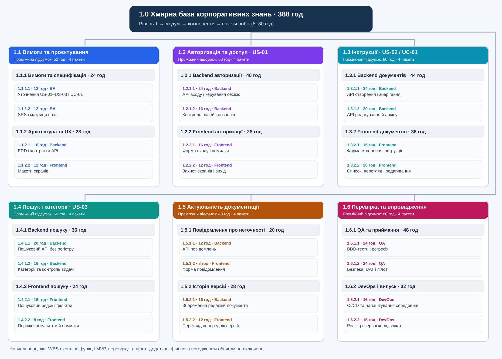

# Лабораторна №6

**Тема:** Декомпозиція робіт (WBS) на основі користувацьких історій.  
**Мета:** Перетворити вимоги з лабораторної №5 на ієрархію пакетів робіт, перевірити правила 100% та 8/80 і підготувати два записи словника WBS.

**Навчальний проєкт:** «Розробка та впровадження хмарного прикладного сервісу управління корпоративними знаннями та технічною документацією».

У лабораторній №5 я описав три користувацькі історії: **US-01 — авторизація**, **US-02 — створення інструкцій**, **US-03 — пошук інструкцій**, а також **UC-01 — створення та збереження технічної інструкції**. Тепер розподіляю цей обсяг на інженерні пакети робіт.

**Межі WBS:** охоплюю функціонал MVP із лабораторної №1 (авторизація та ролі, робота з документами, категорії й пошук, історія версій, повідомлення про неточності), спільне проєктування, QA, розгортання та пілотне тестування. Окремий мобільний застосунок, ШІ-генерація інструкцій, інтеграції BankID/Дія та зміна теми інтерфейсу **не входять** до погодженого обсягу цієї WBS. Це потрібно для дотримання правила 100%.

**Ролі у WBS — це спеціалізації робіт, а не обов'язково додаткові працівники.** У межах навчального складу команди функції BA може виконувати PM, DevOps-завдання — один із розробників, а QA працює з частковою зайнятістю. Так зберігається узгодженість із Project Charter з лабораторної №1.

## Крок 1. Графічна WBS (4 рівні)

**Рівень 1** — продукт загалом (1.0). **Рівень 2** — шість великих блоків (1.1–1.6). **Рівень 3** — 12 компонентів. **Рівень 4** — 24 кінцеві пакети робіт із чітким кодом, роллю та оцінкою.



[Відкрити схему окремо (SVG)](wbs_lab_06.svg) · [Відкрити редагований файл Draw.io](wbs_lab_06.drawio)

Діаграму можна відредагувати у **diagrams.net (Draw.io)** через відкриття файлу `wbs_lab_06.drawio`. SVG додається до звіту як статичне зображення. Нижче дублюю структуру текстом для перевірки ієрархії.

### Повне дерево WBS

```text
1.0 Хмарний сервіс управління корпоративними знаннями (388 год)
  1.1 Вимоги та проєктування (52 год)
    1.1.1 Вимоги та специфікація (24 год)
      1.1.1.1 Уточнення US-01–US-03 і UC-01 — 12 год, BA
      1.1.1.2 SRS і матриця прав — 12 год, BA
    1.1.2 Архітектура та UX (28 год)
      1.1.2.1 ERD і контракти API — 16 год, Backend
      1.1.2.2 Макети екранів — 12 год, Frontend
  1.2 Авторизація та доступ · US-01 (68 год)
    1.2.1 Backend авторизації (40 год)
      1.2.1.1 API входу і керування сесією — 24 год, Backend
      1.2.1.2 Контроль ролей і дозволів — 16 год, Backend
    1.2.2 Frontend авторизації (28 год)
      1.2.2.1 Форма входу і помилки — 16 год, Frontend
      1.2.2.2 Захист екранів і вихід — 12 год, Frontend
  1.3 Інструкції · US-02 / UC-01 (80 год)
    1.3.1 Backend документів (44 год)
      1.3.1.1 API створення і зберігання — 24 год, Backend
      1.3.1.2 API редагування й архіву — 20 год, Backend
    1.3.2 Frontend документів (36 год)
      1.3.2.1 Форма створення інструкції — 16 год, Frontend
      1.3.2.2 Список, перегляд і редагування — 20 год, Frontend
  1.4 Пошук і категорії · US-03 (60 год)
    1.4.1 Backend пошуку (36 год)
      1.4.1.1 Пошуковий API без регістру — 20 год, Backend
      1.4.1.2 Категорії та контроль видачі — 16 год, Backend
    1.4.2 Frontend пошуку (24 год)
      1.4.2.1 Пошуковий рядок і фільтри — 16 год, Frontend
      1.4.2.2 Порожні результати й помилки — 8 год, Frontend
  1.5 Актуальність документації (48 год)
    1.5.1 Повідомлення про неточності (20 год)
      1.5.1.1 API повідомлень — 12 год, Backend
      1.5.1.2 Форма повідомлення — 8 год, Frontend
    1.5.2 Історія версій (28 год)
      1.5.2.1 Збереження редакцій документа — 16 год, Backend
      1.5.2.2 Перегляд попередніх версій — 12 год, Frontend
  1.6 Перевірка та впровадження (80 год)
    1.6.1 QA та приймання (48 год)
      1.6.1.1 BDD-тести і регресія — 24 год, QA
      1.6.1.2 Безпека, UAT і пілот — 24 год, QA
    1.6.2 DevOps і випуск (32 год)
      1.6.2.1 CI/CD та налаштування середовищ — 16 год, DevOps
      1.6.2.2 Реліз, резервні копії, відкат — 16 год, DevOps
```

### Зв'язок WBS із вимогами попередніх лабораторних

| Вимога / результат | Відповідні блоки WBS | Що покривається |
|---|---|---|
| **US-01** Авторизація | **1.2**, 1.6.1 | Вхід, сесії, помилки входу, контроль ролей, тести |
| **US-02** Створення інструкції / **UC-01** | **1.3**, 1.6.1 | Перевірка прав, форма, API, збереження, перегляд, порожні поля, тести |
| **US-03** Пошук | **1.4**, 1.6.1 | Пошук без залежності від регістру, відсутність збігів, категорії й результати |
| Інші функції затвердженого MVP із ЛР №1 | **1.3**, **1.5** | Редагування, архівування, історія версій та повідомлення про неточності |
| Спільні обов'язкові результати проєкту | **1.1**, **1.6** | Вимоги, дизайн, тестування, CI/CD, розгортання, UAT і пілот |
| **SMART-критерії з ЛР №1** | **1.6.1.1**, **1.6.1.2**, **1.6.2.2** | Підготувати й виконати 20 функціональних тестів (не менше 18 успішних), розгорнути MVP до 14.12.2026, провести пілот із 15 працівниками (не менше 12 знаходять інструкцію за 2 хвилини або швидше) до 28.12.2026 |

### Перевірка правила 100%

**Правило 100%:** усі дочірні компоненти кожного батьківського елемента разом покривають **весь його погоджений обсяг**, без пропусків і без сторонніх функцій. Кожен кінцевий пакет у дереві належить одному батьківському компоненту, а його результат відрізняється від інших.

| Код розділу | Великий блок | Сума компонентів (год) | Разом (год) | 100% покриття |
|---|---|---:|---:|---|
| 1.1 | Вимоги та проєктування | 24 + 28 | **52** | Так |
| 1.2 | Авторизація та доступ · US-01 | 40 + 28 | **68** | Так |
| 1.3 | Інструкції · US-02 / UC-01 | 44 + 36 | **80** | Так |
| 1.4 | Пошук і категорії · US-03 | 36 + 24 | **60** | Так |
| 1.5 | Актуальність документації | 20 + 28 | **48** | Так |
| 1.6 | Перевірка та впровадження | 48 + 32 | **80** | Так |
| **1.0** | **Весь погоджений обсяг WBS** | **52 + 68 + 80 + 60 + 48 + 80** | **388** | **Так** |

У дереві немає «нічийних» робіт: усі 24 пакети входять у 12 компонентів, а ті — у шість модулів. Відповідно, сума трудомісткості всіх листових пакетів дорівнює 388 людино-годинам. Перевірка за функціями також показує, що вимоги з ЛР №1, №3 і №5 мають визначені блоки WBS, а роботи, які не входять до погодженого MVP, виключено. **Самої рівності сум годин недостатньо для правила 100%: важливі ще повнота змісту й відсутність дублювання. Оцінки годин залишаються попередніми.**

## Крок 2. Валідація пакетів робіт за правилом 8/80

Для контролю обираю чотири пакети різної спеціалізації. Їхні коди й назви точно відповідають дереву з кроку 1.

| Код WBS | Пакет робіт | Планова оцінка | Виконавець | Перевірка 8/80 |
|---|---|---:|---|---|
| **1.3.1.1** | API створення і зберігання | **24 год** | **Backend** | ✅ У межах 8–80 |
| **1.3.2.1** | Форма створення інструкції | **16 год** | **Frontend** | ✅ У межах 8–80 |
| **1.6.1.1** | BDD-тести і регресія | **24 год** | **QA** | ✅ У межах 8–80 |
| **1.6.2.1** | CI/CD та налаштування середовищ | **16 год** | **DevOps** | ✅ У межах 8–80 |

**Перевірка всього дерева:** найкоротший пакет — **8 год**, найдовший — **24 год**, отже всі 24 Work Packages перебувають у межах **8–80 годин**.

Правило 8/80 — **рекомендований орієнтир деталізації**, а не обов'язковий міжнародний стандарт для кожного проєкту. Пакет менш ніж на 8 годин часто перетворюється на мікрозадачу, а понад 80 годин може бути складно оцінювати та контролювати. Якщо пакет занадто великий, його слід деталізувати. Час різних виконавців не слід плутати з календарною тривалістю всього проєкту.

## Крок 3. WBS Dictionary (Словник пакетів робіт)

Для словника обрав **Backend (1.3.1.1)** та **Frontend (1.3.2.1)** з однієї User Story **US-02**. Так простіше узгодити роботу двох спеціалістів у межах Use Case UC-01.

| Параметр WBS Dictionary | Пакет №1 — Backend | Пакет №2 — Frontend |
|---|---|---|
| **Код та назва WBS** | **1.3.1.1 — API створення і зберігання** | **1.3.2.1 — Форма створення інструкції** |
| **Батьківська User Story** | **US-02** «Створення технічної інструкції» (ЛР №5), UC-01, доступ за ролями | **US-02** «Створення технічної інструкції» (ЛР №5), UC-01 |
| **Технічний опис** | Розробити REST API для збереження інструкції (назва, текст), перевірку обов'язкових полів, сесії та прав редактора; запис у БД і коректні відповіді HTTP. | Створити адаптивну форму з полями назви й тексту, клієнтською перевіркою, відправленням до API, повідомленнями про успіх/помилки. |
| **Відповідальна роль** | Backend Developer | Frontend Developer |
| **Критерії завершення / DoD** | Валідні дані редактора створюють документ у БД (HTTP 201); порожні поля — HTTP 400; без входу — HTTP 401; читач — HTTP 403; є unit/API-тести, code review та опис контракту API. | Обидва поля обов'язкові; порожні не надсилаються; успішне збереження показує підтвердження та новий документ у списку; помилки API обробляються; адаптивний інтерфейс протестовано і пройдено code review. |
| **Ресурси та залежності** | Погоджені UC-01 та критерії з ЛР №5; **1.1.2.1** (ERD і API); тестова БД, GitHub та середовище розробки. | Макети **1.1.2.2**, контракт і робочий endpoint **1.3.1.1**, тестовий обліковий запис редактора. |
| **Оцінка трудомісткості** | **24 години** | **16 годин** |
| **Результат (Deliverable)** | Перевірений endpoint створення інструкцій із серверною валідацією й контролем ролей. | Готовий екран створення інструкції, під'єднаний до API. |

**Межі пакетів:** backend-пакет завершується створенням API, валідацією на сервері та збереженням у БД. Frontend-пакет — готовою формою, інтегрованою з цим API. Загальна QA-регресія з пакета **1.6.1.1** не дублюється в цих двох пакетах; їхні unit- та компонентні перевірки входять у власний Definition of Done.

## Контрольні запитання

### 1. Що означає правило 100% та як воно запобігає Scope Creep?

Правило 100% означає, що сума дочірніх елементів WBS повністю описує погоджений обсяг батьківського елемента. Якщо під час побудови дерева з'являється нова функція, я перевіряю, чи передбачена вона в затверджених вимогах. Якщо ні — її не можна непомітно додати до робіт, потрібно окремо оцінити та погодити зміну. Це зменшує ризик **Scope Creep** — неконтрольованого розширення проєкту.

### 2. Чому рекомендують пакети робіт від 8 до 80 годин?

Пакети менші за 8 годин можуть створити забагато дрібних елементів для контролю. Роботи понад 80 годин часто містять кілька різних результатів, тому ризики й прогрес важко оцінити. Діапазон 8–80 — практична рекомендація, яку можна адаптувати до складності та розміру команди.

### 3. Чим відрізняється WBS від OBS і Scrum Backlog?

**WBS (Work Breakdown Structure)** показує, *який обсяг результатів* треба створити, від загального проєкту до пакетів робіт. **OBS (Organizational Breakdown Structure)** показує *хто* бере участь у проєкті та як організована відповідальність (відділи, ролі). **Scrum Product Backlog** — упорядкований за цінністю список вимог і покращень, який змінюється під час розвитку продукту. Отже, WBS описує структуру погодженого обсягу, OBS — організацію команди, а Backlog — пріоритети продукту.

### 4. Для чого потрібен WBS Dictionary під час приймання робіт?

WBS Dictionary фіксує код і назву пакета, його зміст, відповідального, залежності, оцінку та **критерії завершення**. Завдяки цьому розробник і замовник однаково розуміють, що саме потрібно здати. Наприклад, для backend API створення інструкцій недостатньо просто написати код: повинні виконуватися перевірки прав, повертатися узгоджені статуси, а функція має бути протестована. Якщо виникає суперечка, словник дає перевірювану основу для приймання.

## Загальний висновок

У лабораторній №6 я перетворив три User Stories і Use Case з попередньої роботи на **чотирирівневу WBS** із 24 пакетами загальною навчальною оцінкою **388 людино-годин**. Перевірив правило 100% на кожному рівні, підтвердив дотримання рекомендації 8/80, оцінив чотири пакети різної спеціалізації та оформив словник для двох взаємопов'язаних робіт Backend і Frontend. Я зрозумів, як на основі вимог організувати обсяг робіт без пропусків та чітко визначити, за якими ознаками приймати результат.
