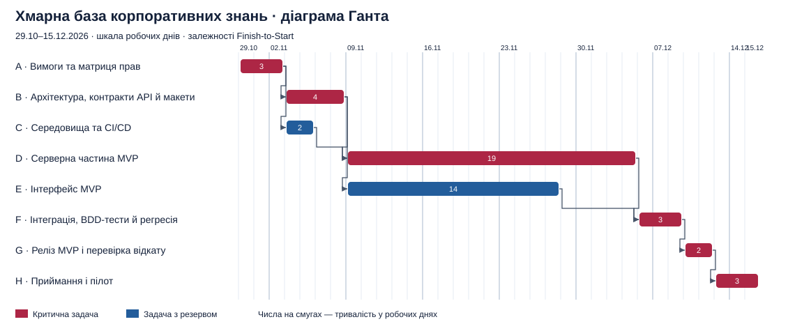

# Лабораторна №8

**Тема:** Побудова розкладу та діаграми Ганта  
**Мета:** Встановити залежності між пакетами WBS, побудувати календарний графік і визначити критичний шлях методом CPM.  
**Тема кваліфікаційної роботи:** «Розробка та впровадження хмарного прикладного сервісу управління корпоративними знаннями та технічною документацією».

## Крок 1. Аналіз залежностей

Укрупнив 24 пакети робіт із [WBS лабораторної №6](lab_06.md) у вісім задач A–H. Графік охоплює авторизацію й ролі, інструкції, категорії та пошук, версії, повідомлення про неточності, випуск і пілот. Вимоги до авторизації, створення та пошуку інструкцій узято з [лабораторної №5](lab_05.md).

Тривалість кожної групи отримано діленням її трудомісткості на 8 людино-годин за робочий день і округленням угору. Це навчальна модель, у якій потрібні виконавці доступні для запланованих паралельних робіт, а QA має достатню доступність у відведені дні. Усі зв’язки мають тип **Finish-to-Start (FS)** без затримки. Робочий календар — понеділок–п’ятниця. Для навчального графіка прийнято початок **29.10.2026**.

| ID | Назва задачі | Код WBS | Люд.-год | Робочі дні | Попередники |
|---|---|---|---:|---:|---|
| A | Вимоги та матриця прав | 1.1.1 | 24 | 3 | — |
| B | Архітектура, контракти API й макети | 1.1.2 | 28 | 4 | A |
| C | Середовища та CI/CD | 1.6.2.1 | 16 | 2 | A |
| D | Серверна частина MVP | 1.2.1, 1.3.1, 1.4.1, 1.5.1.1, 1.5.2.1 | 148 | 19 | B, C |
| E | Інтерфейс MVP | 1.2.2, 1.3.2, 1.4.2, 1.5.1.2, 1.5.2.2 | 108 | 14 | B |
| F | Інтеграція, BDD-тести й регресія | 1.6.1.1 | 24 | 3 | D, E |
| G | Реліз MVP і перевірка відкату | 1.6.2.2 | 16 | 2 | F |
| H | Приймання і пілот | 1.6.1.2 | 24 | 3 | G |

- **A → B, C.** Після уточнення вимог можна паралельно проєктувати продукт і налаштовувати середовища.
- **B, C → D.** Серверна розробка спирається на погоджені контракти, модель даних і готове середовище.
- **B → E.** Інтерфейс можна розробляти за макетами та контрактами API, використовуючи тимчасові відповіді API. Він виконується паралельно із серверною частиною.
- **D, E → F.** Наскрізна перевірка починається після готовності серверної частини та інтерфейсу. F включає перевірку їхньої інтеграції та регресію.
- **F → G → H.** Після регресії команда випускає MVP і перевіряє готовність до відкату. Після випуску проводиться пілот із прийманням.

## Крок 2. Діаграма Ганта

Діаграму побудовано програмно у форматі SVG за датами й залежностями з таблиці. Стрілки показують зв’язки FS. Червоним позначено задачі з нульовим резервом. Реліз MVP завершується **10.12.2026**, приймання й пілот — **15.12.2026**. Обидві дати вкладаються в цільові строки WBS, відповідно 14 і 28 грудня.

## Крок 3. Критичний шлях (CPM)

Прямий прохід починається з нуля. Ранній початок (ES) дорівнює найбільшому ранньому завершенню серед попередників, а раннє завершення (EF) — сумі ES і тривалості. Для зворотного проходу пізнє завершення (LF) останньої задачі дорівнює 34. Для інших задач LF дорівнює найменшому пізньому початку серед наступників. Пізній початок (LS) дорівнює LF мінус тривалість. Повний резерв — `LS − ES`.

Значення ES, EF, LS і LF — межі інтервалів у робочих днях від початку. Календарні дати в таблиці включають перший і останній робочий день задачі.

| ID | Початок | Завершення | ES | EF | LS | LF | Резерв, дні |
|---|---|---|---:|---:|---:|---:|---:|
| A | 2026-10-29 | 2026-11-02 | 0 | 3 | 0 | 3 | 0 |
| B | 2026-11-03 | 2026-11-06 | 3 | 7 | 3 | 7 | 0 |
| C | 2026-11-03 | 2026-11-04 | 3 | 5 | 5 | 7 | 2 |
| D | 2026-11-09 | 2026-12-03 | 7 | 26 | 7 | 26 | 0 |
| E | 2026-11-09 | 2026-11-26 | 7 | 21 | 12 | 26 | 5 |
| F | 2026-12-04 | 2026-12-08 | 26 | 29 | 26 | 29 | 0 |
| G | 2026-12-09 | 2026-12-10 | 29 | 31 | 29 | 31 | 0 |
| H | 2026-12-11 | 2026-12-15 | 31 | 34 | 31 | 34 | 0 |

**Критичний шлях — A → B → D → F → G → H.** Його тривалість становить **3 + 4 + 19 + 3 + 2 + 3 = 34 робочі дні**. До завершення релізу G минає **31 робочий день**. За заданих залежностей і доступності виконавців 34 дні є мінімумом. Задачі C та E мають відповідно **2** і **5** робочих днів резерву.

## Контрольні запитання

1. **Що таке Finish-to-Start?** Наступну роботу можна почати після завершення попередньої. Наприклад, фарбувати стіну можна після завершення ґрунтування й висихання ґрунтовки.
2. **Що таке критичний шлях і навіщо стежити за ним щодня?** Це найдовший за тривалістю ланцюжок залежних задач, який визначає найранішу дату завершення проєкту. Його задачі мають нульовий повний резерв. Якщо серверна розробка D затримається на день і графік не скоригувати, на день змістяться реліз і завершення пілоту. Щоденний контроль допомагає вчасно виявляти блокування.
3. **Чи можуть існувати два критичні шляхи?** Так, якщо два паралельні ланцюжки мають однакову максимальну тривалість. Затримка на будь-якому з них може змістити завершення, тому менеджеру доведеться контролювати обидва.
4. **Що буде, якщо копірайтинг із резервом 3 дні затримається на 2 дні?** Дата релізу залишиться тією самою за інших незмінних умов. Затримка використає два дні резерву, залишиться один.
5. **Чому детальна діаграма Ганта малоефективна для інноваційного стартапу в Scrum?** Після кожного спринту зворотний зв’язок і нові дані можуть змінювати пріоритети, обсяг і порядок робіт. Детальний довгостроковий графік доведеться часто переглядати. У Scrum поточну роботу зручніше планувати через Product Backlog, ціль спринту та Sprint Backlog. Діаграма Ганта може бути доречною для кількох зовнішніх залежностей або фіксованих дат.

## Висновок

На основі WBS побудовано календар від уточнення вимог до приймання та пілоту. Паралельне виконання проєктування і підготовки середовищ, а також розробки сервера й інтерфейсу дає розрахункову тривалість **34 робочі дні**.
